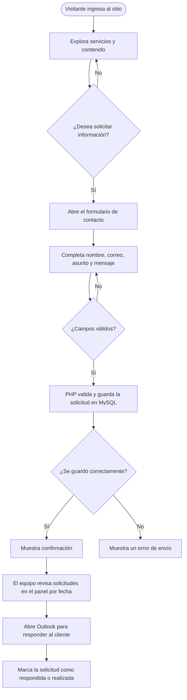
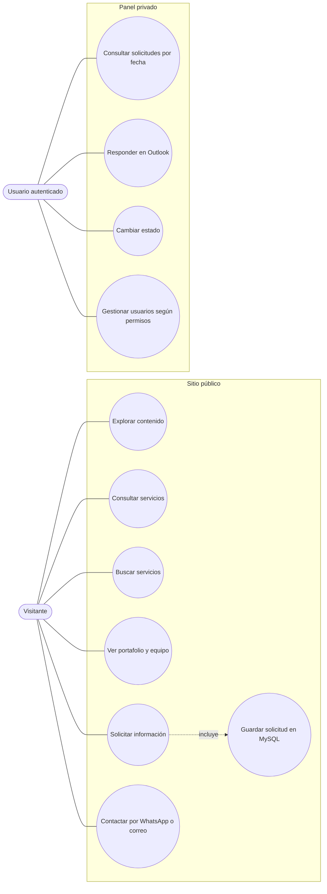
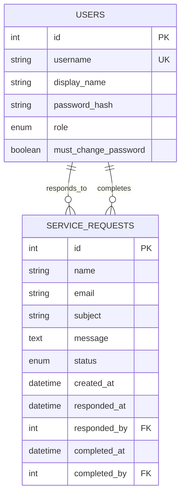

# Diagramas de GC Technical Solutions

Estos diagramas describen la navegación pública y el panel privado de solicitudes.

## Diagrama de flujo

## Diagrama de casos de uso

## Diagrama entidad-relación

El asunto conserva el servicio seleccionado desde el formulario. Las solicitudes no crean cuentas de cliente.

## Alcance implementado

- Los botones de los servicios completan el asunto del formulario.
- PHP valida y persiste las solicitudes en MySQL.
- El panel requiere autenticación y permite consultar por fecha, actualizar estados y abrir Outlook para responder.
- Las cuentas internas se crean desde el panel o mediante el comando inicial de administración.
- El formulario de suscripción del pie de página está comentado y no forma parte del flujo activo.
