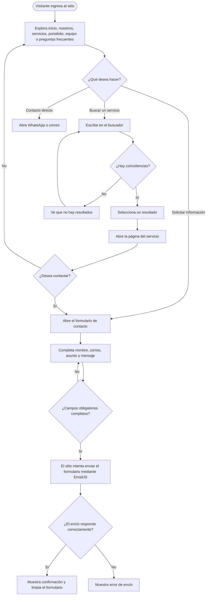
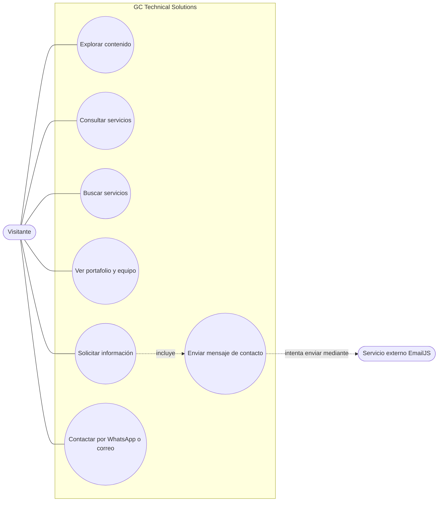
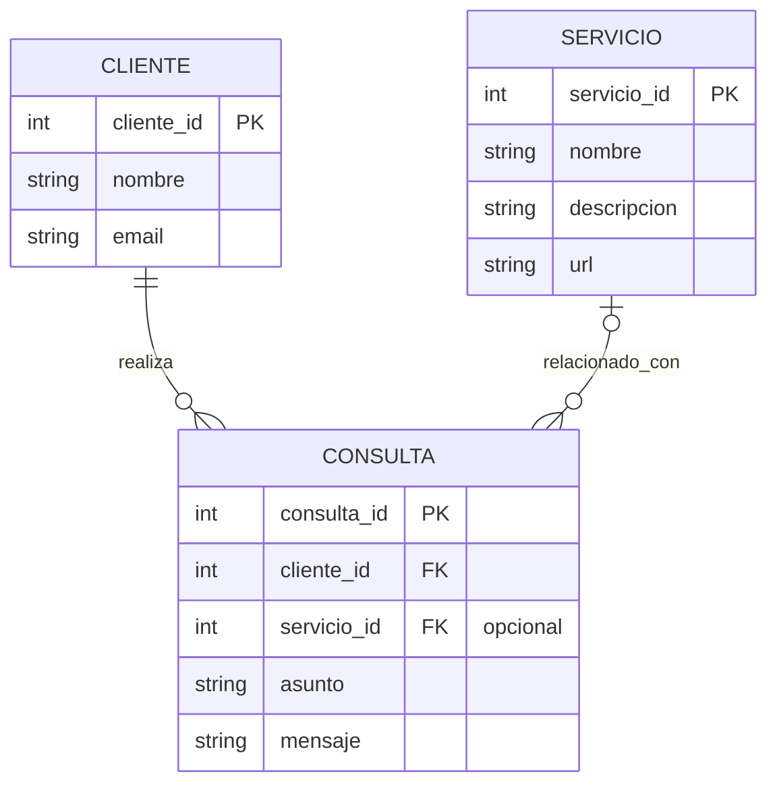

# Diagramas de GC Technical Solutions

Los siguientes diagramas describen la navegación y las funciones visibles del sitio actual. El diagrama entidad-relación es un **modelo conceptual propuesto**: el proyecto no tiene una base de datos ni persiste clientes o consultas.

## Diagrama de flujo

## Diagrama de casos de uso

## Diagrama entidad-relación conceptual

Este modelo sirve como base si más adelante se incorpora persistencia. `servicio_id` sería opcional: el formulario actual no registra qué servicio originó la consulta.

### Alcance actual

- La búsqueda del menú filtra servicios definidos en JavaScript y abre la página seleccionada.
- El formulario de contacto recoge nombre, correo, asunto y mensaje. Su integración usa identificadores de EmailJS de ejemplo, por lo que requiere configuración para enviar mensajes.
- No se guardan clientes ni consultas en una base de datos.
- El formulario de suscripción del pie de página está comentado y no forma parte del flujo activo.
